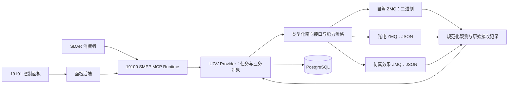

# UGV 南向 ZMQ 迁移范围与缺口评估

日期：2026-10-23，更新：2026-10-24。状态：第一阶段本地合同基础已实现并复查；第二阶段只读观测与存档已实现并验证，详见 `docs/execplans/ugv-zmq-migration-20261023.md` 和 `reports/ugv-zmq-phase2/REPORT.md`。G0 的部署身份、服务端证据及约定仍待确认；当前运行实例保持原配置。

本次迁移需要同时改造南向通信、任务身份与恢复、能力合同、观测证据和控制面板。浏览器仍通过面板后端访问 SMPP MCP Runtime；MCP 继续作为北向接口。ZMQ 用于替换设备侧的 MCP/MQTT 接入。

用户已确认“火炮”等名称表示仿真功能。原协议第 6 节也明确执行后端是 ROS 裁判与 CARLA 虚拟实体。因此本设计包含完整的**仿真效果交互**业务；结果必须来自该仿真执行后端。文档展示名称已统一，原有线路标识仍按兼容协议解释。名称不改变功能含义。

## 依据与实际基线

源码分析基于已包含控制面板、检查任务和轨迹历史功能的提交 `d26002f127a4152ee1dc034950501be2f182b6ea`，工作树位于 `/home/sz/.codex/worktrees/trajectory-history-authority/sdar-mcp-provider-platform`。主工作区现有联合打包修改未纳入本次编辑。

| 资料                                                               | 本次核对版本                   | 用途                     |
| ------------------------------------------------------------------ | ------------------------------ | ------------------------ |
| [自驾 ZMQ 协议](/home/sz/Documents/zmq/自驾ZMQ对接协议.md)         | V2.0，2026-10-23               | 二进制消息、导航和状态   |
| [光电 ZMQ 协议](/home/sz/Documents/zmq/光电ZMQ对接协议.md)         | V2.2，2026-10-20               | 搜索、遥控、观测和覆盖   |
| [仿真效果 ZMQ 协议](/home/sz/Documents/zmq/仿真效果ZMQ对接协议.md) | V1.0，2026-10-23；展示术语修订 | ROS/CARLA 仿真任务与效果 |
| [术语与兼容说明](/home/sz/Documents/zmq/术语与兼容说明.md)         | 2026-10-23                     | 名称映射、线路兼容边界   |

只读检查现有容器确认：设备 MCP 为 `http://192.168.2.63:19000/mcp`，MQTT 为 `mqtt://192.168.2.63:1883`，另外启用了 `http://192.168.2.63:7879` 的路线规划服务。区域检查和轨迹历史开启，旧效果控制开关 `UGV_FIRE_ENABLED=false`，当前 Provider 的执行域配置为 `live`。这最后一项不能直接当作新 CARLA 仿真能力的发布域，需要重新配置、验证和发布。

已部署适配器镜像为 `smpp-recovery/adapter:20261022-f67fd0a`，面板为 `smpp/ugv-control-console:20261023-availability-18d6754`。源码基线与运行镜像分别记录，实施前须冻结三者的具体版本。

设计输入最初只有协议文档。第一阶段已通过限定时长的 SUB 被动订阅，观察到自驾 `systemId=1`、光电 `isr-01`（2.2）和仿真效果 `artillery-01`（1.0）；留存报文通过合同校验。这些观测不能替代提供方确认的部署清单、控制黄金帧及 ROS 服务端源码，仍未发送设备控制请求。协议中的部署步骤没有直接执行。

## 建议架构

建议在 Provider 内新增 ZMQ 驱动，并抽出不依赖 MQTT/MCP 名称的南向接口。旧驱动保留为过渡配置。避免把所有新消息先伪装成旧 MQTT topic、旧整数任务号和旧 MCP 工具回执：这会隐藏新协议的缺失字段，并沿用错误的资格判断。

| 子系统   | 平台连接方式                               | 线路格式                                               | 设计重点                                   |
| -------- | ------------------------------------------ | ------------------------------------------------------ | ------------------------------------------ |
| 自驾     | PUB connect 到 10001；SUB connect 到 11001 | 单帧 `topic:` 加小端二进制，24 字节通用头、payload CRC | 独立二进制编解码、异步反馈、模式与任务时序 |
| 光电     | REQ connect 到 5555；SUB connect 到 5556   | 请求单帧 JSON；上报 topic/JSON 两帧                    | 请求与任务分别关联，动作回执与完成状态分离 |
| 仿真效果 | REQ connect 到 5557；SUB connect 到 5558   | 独立 V1.0 JSON、独立 topic 和设备身份                  | 一次仿真动作、异步结果、未知结果保留       |

上述端口来自协议，不代表三个服务必定部署在同一 IP。配置应分别绑定 endpoint、设备 ID、协议版本和来源类别。ZMQ PUB/SUB 可以丢失消息，连接建立或发送入队不等于业务受理；REQ 的收发状态机也不能被当作任意并发 RPC。实现遵循 [libzmq socket 文档](https://libzmq.readthedocs.io/en/latest/zmq_socket.html)。

Node.js/TypeScript 可评估官方项目的 [ZeroMQ.js](https://zeromq.github.io/zeromq.js/)。它包含原生绑定，Docker 与 arm64 包须验证目标平台安装或编译，不能仅凭 TypeScript 构建通过认定可部署。通信参数在建链前明确配置；光电与效果服务的 multipart 通道不能使用 CONFLATE，依据 [libzmq 参数文档](https://libzmq.readthedocs.io/en/latest/zmq_setsockopt.html)。

## 代码改动范围

| 模块与现有位置                                                       | 必要修改                                                                                  | 程度               |
| -------------------------------------------------------------------- | ----------------------------------------------------------------------------------------- | ------------------ |
| `apps/ugv-provider-adapter/src/main.ts`、`config.ts`                 | 根据受控配置装配自驾、光电、仿真效果驱动；分别管理健康与重连                              | 大                 |
| `apps/ugv-provider-adapter/src/runtime.ts`                           | 抽出旧工具调用流程；按新驱动实现任务阶段、身份、结果未知和重启对账                        | 大                 |
| `packages/vehicle-device-mcp-client`                                 | 旧实现保留；上层不再依赖 MCP 工具发现、数字 mission ID 与旧方法名                         | 大                 |
| `packages/vehicle-mqtt-ingress`、`vehicle-provider-core`             | 抽出通用观测入口、字段来源、时间质量、连接状态与互斥判断；避免影响共享此包的其他 Provider | 大                 |
| Provider 的 `manifest.ts`、`capabilities.ts` 与资格模块              | 用版本化 ZMQ 合同、部署能力和实测资格生成目录；缺失能力拒绝发布或拒绝准入                 | 大                 |
| `recon-execution-correlation.ts`、`inspection-report.ts`、业务处理器 | 支持真实 ZMQ 来源、字符串任务 ID、逐帧观测、截断及覆盖证据等级                            | 大                 |
| `packages/trajectory-history`                                        | 新接收记录版本，保留二进制原始来源与 ZMQ 元数据；不能伪造 MQTT QoS/packetId               | 大                 |
| 配置合同、`schemas/config/provider.ugv.*`、Provider 包               | endpoint/身份/能力档案/物理限值/来源类型及校验规则                                        | 中                 |
| `apps/ugv-control-console`                                           | 分子系统连接状态、实际参数限制、缺口提示、新仿真任务表单和效果展示                        | 中至大             |
| 部署、预检、模拟设备与测试                                           | ZMQ 原生依赖、端口路由、仿真夹具、发布/回退、证据归档                                     | 中至大             |
| SMPP Runtime/TaskExecution/TaskBusiness 基础协议                     | 复用现有框架；更新 Provider 工具合同和目录版本，不重写冻结协议                            | 小；需完整兼容验证 |
| SDAR 消费者与联合包                                                  | 按新目录 checksum、Schema、Task Profile 更新能力绑定和组合资格                            | 中，跨项目协调     |

建议新增三个职责模块：`vehicle-southbound`（类型化操作及观测合同）、`vehicle-zmq-transport`（socket、帧与校验）、`ugv-zmq-driver`（三个子系统的业务映射）。名称为设计建议，尚未创建代码。只有确实需要共享的传输逻辑进入通用包，不能把所有业务塞入一个万能 JSON 转发器。

已有公开 DTO 也存在必须修订的约束：`VehicleStateV1` 强制要求 `mqttConnected`、`deviceMcpConnected`、`mqttIngressSequence`，且不接受额外字段；`VehicleCapabilitiesV1.source` 固定为 `device_mcp`。因此不能承诺所有工具 Schema 原封不动。建议发布新 Provider 合同版本，使用通道类型及状态表达连接、使用通用观测序号，并保留旧版本解码。不能把 ZMQ 在线伪报成 MQTT/MCP 在线。

复核补充：现有业务 profile 也必须作为代码迁移项。`deploy/development/server/profiles/ugv-business.json` 开启了 Provider 视觉锁定、人工决策、机场估计足迹和导航调整；启动验证将它们与 7879 规划器及旧坐标模型绑定。仅关闭规划器或替换南向驱动，会触发启动拒绝或残留旧工具调用。新增独立 ZMQ 业务 profile：保留 TaskBusiness 存储和已资格化的轨迹/覆盖来源；在缺少新合同前关闭视觉锁定、相关人工决策、机场估计足迹和导航调整，同时移除对应旧坐标转换声明。原部署 profile 不直接覆盖。

`simulation_apply_effect` 还必须贯通操作注册、资格矩阵、轨道/占用映射、启动校验、Task Profile、结果校验、TaskBusiness 绑定、面板白名单与任务分类。当前 Runtime 的操作集合来自 `UGV_OPERATION_TRACKS`，新名字仅出现在 manifest 中会被 `UGV_OPERATION_UNSUPPORTED` 拒绝。验收须通过正式 `tools/call` 到持久任务及业务结果，不能只检查目录中出现了工具。

## 现有功能与 ZMQ 支持程度

“可适配”表示文档提供基础语义，并非已经通过设备验收。

| 当前或计划功能                   | 文档支持                                                  | 落地结论                                                                                       |
| -------------------------------- | --------------------------------------------------------- | ---------------------------------------------------------------------------------------------- |
| 状态、位置、速度、任务、健康读取 | 自驾周期状态与定位；光电设备/任务快照；效果服务状态       | 可适配，但能源、部件细项及未确认时间语义保留未知                                               |
| 能力查询                         | 无等价 `tools/list` 或完整能力查询                        | 新增本地版本化能力档案，区分文档声明、部署确认和实测资格                                       |
| 单点导航、路线路点、返航         | 自驾有对应任务与任务状态                                  | 可适配，受反馈关联、单控制者和时间语义缺口限制                                                 |
| 方向/距离移动                    | 无同义原生接口                                            | 首版不承诺等价支持；不能把倒车或相对运动简单改成地理目标点                                     |
| 速度、绕障配置                   | 有设置消息，速度有系统状态回显                            | 核对回显；绕障开关缺少明确独立确认，不能静默忽略配置                                           |
| 原生巡逻任务                     | 枚举含巡逻，完整任务表仅列三类任务                        | 文档待补；SDAR 的组合巡逻可由已资格化导航/检查构成，不能称原生巡逻已支持                       |
| 路线预览、导航计划调整           | 全局路径只上报一次；无计划版本、查询和原位替换合同        | 保留 7879 服务须明确其有效性；否则缩减此能力，不能把一次路线消息当完整规划服务                 |
| 区域侦察/检查                    | 光电区域搜索、任务控制、识别列表及覆盖比例                | 基础可适配；限四点严格凸区域与约定水平面，完整检查报告另有缺口                                 |
| 任意合法多边形子区域             | 当前检查支持 3～256 个有效点；新协议限定四点凸区域        | 不能直接兼容。首版明确拒绝超出约束的区域；区域分解是独立后续能力，不能扩大为外包矩形冒充原区域 |
| 环视与扇扫                       | 光电支持有限循环 circular/sector                          | 发布实际支持变体；机械是否能完整周扫需部署资格。现有区域/环视表单需扩展扇扫参数                |
| 云台绝对角度、变焦               | 光电遥控提供对应动作及完成状态                            | 可适配；度/弧度、绝对倍率/旧变焦增量语义必须明确转换                                           |
| 云台相对角度、复位               | 没有独立同义动作                                          | 只有已确认坐标系、当前位置、零位和独占控制时才能定义组合；不能伪称已支持原生复位               |
| 云台速度动作                     | 有本地速度租期                                            | 可作为新增受期限约束能力；续租、失焦、连接断开和服务端执行到期必须验证                         |
| 指定观测对象跟踪                 | 光电由设备选择一个对象，没有人工指定对象接口              | 现有 `vehicle_track_target(targetId)` 不具等价实现；不能把自动选择结果伪装成用户指定目标       |
| 独立测距                         | 测距仅作为特定观测结果，不是独立请求接口                  | 不发布同步测距工具；可展示有关联且有效的已观测值                                               |
| 人工观察决策、旧锁定流程         | 未提供旧锁定/确认流程的等价合同                           | 普通任务暂停/恢复可复用；旧 RequiredInput 生产条件和回执不能原样沿用                           |
| 暂停、恢复、取消                 | 自驾与光电提供基础控制；仿真效果不提供                    | 按操作发布真实生命周期能力，不统一显示所有按钮                                                 |
| 紧急停止                         | 有子系统级终止/遥控停止；无统一、独立确认的全设备急停合同 | 必须定义各组件停止确认和未确认结果；仿真效果已受理动作不可宣称被撤销                           |
| 轨迹历史、证据下载               | 自驾定位 100Hz，ZMQ 没有历史查询                          | 平台新增接收持久化与来源合同；只能证明本平台实际收到的记录                                     |
| 仿真效果交互                     | 独立服务有接纳、任务状态、完成标志和效果                  | 应做成正式任务闭环；现有旧效果工具合同和面板入口均需改造                                       |

## 必须新增的功能

1. **三套来源、两类线路编解码。** 自驾用精确字节边界、小端类型、长度和 CRC 校验，64 位系统 ID 使用无损表示；光电/效果服务严格校验 JSON、双帧 topic 与 device_id 一致性、最大大小和协议版本。JSON 重复键不能被解析器静默覆盖。二进制不得按冒号重复切分。
2. **类型化南向接口。** 上层消费“提交任务、控制任务、观测快照、资格结果和命令结果”，避免依赖旧 MCP `call(name,args)`。自驾、光电、效果任务各有独立占用与健康状态；组合占用仍由业务规则判断。
3. **持久化命令阶段和身份。** 发送前保存逻辑命令 ID、不可变参数摘要、协议/设备/任务映射、阶段和截止时间。自驾任务号由平台分配并防止重启复用；光电/效果的 task_id 当作不透明字符串，不能继续经过旧整数解析。平台接收会话不能冒充设备启动会话。
4. **结果未知与恢复。** socket 超时或重建只恢复通信；可能已发送的任务创建/执行动作保留未确认状态，重连不自动重派。文档明确可重复的同值模式设置单独执行受限重试。按原任务和原请求关联恢复，跨服务重启缺乏证据时保持未知。成功、失败、任务结束和资源可再用必须分别判断。
5. **新鲜度与单位转换。** 分开采集时刻、设备发布时间、平台接收 UTC 和本地单调时间。定位单位、角度参考轴、微秒/毫秒、路点缩放等均有显式转换；时间基准未知不强行解释为 Unix UTC。新连接或新回调不自动证明收到的是新产生的数据。
6. **版本化观测与轨迹存档。** 原始帧摘要、设备/协议、任务和帧引用、来源类别、时间质量写入不可变接收记录。100Hz 定位的持久化能力独立压测；UI 可降采样，证据链不能无记录丢弃入口数据。积压或丢失产生明确缺口记录。
7. **巡检成果汇总。** 记录逐帧观测、有效空报告、来源截断、位置未知、覆盖比例及覆盖来源。帧内 detection ID 不等于跨帧实体 ID；不能把逐帧条目数标成独立对象数量。缺地理位置的发现可列出，但不能放到地图上的猜测位置。
8. **新目录和面板适配。** 根据合同显示状态、可用原因、四点凸约束、高程来源、参数范围、停止未确认和结果未知。新增仿真效果表单和结果视图，并更新后端工具白名单、任务分类、审计及目录绑定。
9. **ZMQ 模拟器和故障注入。** 新增二进制自驾模拟端、光电及仿真效果 JSON 模拟端，覆盖丢包、延迟、回执丢失、重启、重复、乱序、并发客户端、发布积压和错误帧；不能靠旧 MCP mock 证明新链路正确。

现有 PostgreSQL 执行 JSONB、命令日志和 TaskBusiness 对象可优先扩展。轨迹接收记录的严格 Schema 目前含 MQTT 专用常量与字段，需发布新记录版本、兼容旧记录；若任务号分配或检索需要新增索引/计数器，应追加迁移，不修改已冻结迁移。旧证据签名和历史记录继续可验证。

## 仿真效果功能如何做实

建议新增明确归属仿真资源的 `simulation_apply_effect` 工具（候选名），发布独立 Schema 与 Task Profile。现有 `vehicle_fire_weapon` 仅接收目标 ID 等旧字段，并声明不输出命中/损伤语义；`fire-result-sanitizer.ts` 也显式过滤一组裁判字段。把该旧工具改名后复用原处理链，无法满足新协议的真实效果展示。新能力应有独立结果合同，不应全局删除旧结果过滤规则。

一次请求对应一次裁判交互。保存来源观测引用、请求位置快照和原请求 ID，区分以下结果：

| 层次         | 证据                               | 面板与任务含义                                               |
| ------------ | ---------------------------------- | ------------------------------------------------------------ |
| 请求受理     | 原请求对应的 REP 回执              | 已受理，尚非完成                                             |
| 动作执行     | 同一 task_id/request_id 的任务状态 | 执行中、执行成功、执行失败或未知                             |
| 动作是否结束 | `execution_finished`               | 决定是否还保留占用；未知状态也可能独立确认已结束             |
| 仿真效果     | 裁判返回的 `effect`                | 虚拟命中、虚拟未命中、虚拟实体移除或未知；执行成功不保证效果 |

任务由正式 SMPP TaskExecution 承载，包含本地命令去重、审计、原请求恢复查询、任务详情和结果下载。已受理后协议没有暂停/撤销，面板及 Task Profile 应如实限制；客户端停止等待不等于撤销裁判动作。平台预算耗尽也不能释放尚未结束的执行占用，迟到结果仍归入原任务，不重新执行。

如果北向任务已经按时序合同结束，迟到反馈写入绑定原任务的独立附加结果记录和审计记录，按下文定义的新查询合同展示；保持原任务和已归档 Context 的终态。下游未结束占用必须独立于北向任务终态保存，避免任务超时后错误开放下一次请求。

仿真效果服务没有 `data_origin` 字段或服务启动会话，需要以经核实的仿真部署绑定注明 `simulation_referee` 来源，不能仅凭接口名字推断来源。现有 Provider 配置为 `live`，发布时需明确独立仿真身份/资源或受治理的仿真执行域，避免把裁判结果混入实测证据。

验收至少覆盖受理、执行成功但未命中、效果未知、明确失败、反馈超时后迟到完成、重复请求只执行一次、服务重启后不重派、不同任务结果隔离。应使用提供方所述的真实隔离裁判逻辑验收，不能用固定成功响应替代。

## ZMQ 文档尚未提供的关键保证

以下区分“本项目可补”和“必须由服务端补或双方约定”；ZMQ 库自身不能弥补业务协议缺口。

| 缺口                                                                      | 对项目的影响                                                         | 建议处理及归属                                                                       |
| ------------------------------------------------------------------------- | -------------------------------------------------------------------- | ------------------------------------------------------------------------------------ |
| 自驾任务反馈无 mission_id/request_id；控制命令也无任务 ID                 | 串行发送仍可能误认迟到或其他控制端的反馈，不能严格证明受理与控制归属 | 服务端补反馈关联和控制所有权；单写入者只能作为受限联调条件，不能宣称解决跨控制端关联 |
| 自驾系统/任务状态无发布时间、序号和启动代次                               | 文档要求“新模式回显”，但接收时刻不足以证明消息在本次设置后产生       | 服务端补版本化观测标识；本地接收序号只证明接收顺序                                   |
| 光电与效果服务无 boot/session ID、按请求查询；去重账本仅进程内有效        | 回执丢失后跨重启无法可靠恢复原请求，不能保证设备侧恰好一次           | 补启动身份、持久请求账本及按原请求/任务查询；未补齐时禁自动重派并保留未知            |
| 光电 PUB 列表无补发、无完整报告下载；源端截断后条目丢失                   | 本地归档无法补回没收到的发现，无法承诺任务级完整成果                 | 服务端补可验证序号/任务汇总与可读取完整对象；否则报告标部分或完整性未验证            |
| 无完整能力/限值发现                                                       | 无法动态判断变焦范围、云台限位、周扫能力、支持版本等                 | 首版用签定的部署能力档案并实测；后续补能力查询接口                                   |
| 光电限定四点凸区域，输入还要求椭球高                                      | 现有二维任意合法子区域合同不能全部满足                               | 提供方补广义区域支持，或明确发布受限变体；水平面高程必须来自部署约定，不能默认填 0   |
| 自驾定位时间基准、姿态角单位/正方向、高度基准等未完全确认                 | 航向、轨迹、时钟偏差及证据新鲜度可能错误                             | 提供方确认字段语义和原始样例后才能资格化相关能力                                     |
| 自驾无明确遇障事件                                                        | 不能从速度为 0 推导“遇障”、暂停或失败，也无法原样触发遇障人工决策    | 如需该功能补原因事件；首版只呈现实际状态                                             |
| 自驾无任务预算/绝对截止时间，光电预算自首次启动才计时                     | 平台总期限与设备执行期限不等价，准备时间和断线可能导致差异           | 平台监督剩余预算与停止；若要求设备独立保证截止时间，需补设备 deadline/watchdog 合同  |
| 无覆盖所有组件、可独立确认的全设备急停                                    | 不能把一个终止消息或普通 ACK 当全局停止；效果服务无撤销              | 定义组件级确认、未知结果和受限停止范围；完整急停能力需服务端补齐并实测               |
| 全局路径只发一次，无任务关联字段和重取接口                                | 漏收后无路线可恢复；串行场景以外难证明路线归属                       | 补任务/计划版本及查询；保留现有 7879 需提供方明确仍受支持                            |
| TargetList 无地理位置、无跨帧稳定实体身份；无人工指定跟踪入口             | 地图发现、指定对象跟踪及依赖位置的仿真交互不能仅凭检测列表完成       | 保留像素与未知位置；仅使用有效同源定位证据。指定跟踪须提供方新增接口                 |
| 无旧独立测距、能源/电池细项、详细覆盖网格/轨迹、视频帧通道                | 部分表单、状态卡、地图覆盖图和图像展示失去数据来源                   | 逐项降级，缺失字段不填假值；按需求另补接口                                           |
| 光电所有者/FORBIDDEN 语义没有配套身份传递说明；各协议缺鉴权与控制租约合同 | 多控制端共享设备时，难保证调用方身份和抢占规则                       | 明确认证、控制权/租约与端点绑定；网络限制与 ZMQ 安全配置须双方共同确定               |
| 效果服务只保留当前/最近任务，无历史查询与取消，重启可能留下未决动作       | 无法完整补取历史或取消已接纳动作                                     | 平台保存已收证据；服务端补查询/恢复保证或明确长期保留未知，不伪造终态                |

**检查结果完整性尤其需要单独设计。** 光电某帧 `targets=[]` 只证明该有效帧没有识别项；`truncated=false` 只证明这一帧未截断；覆盖比例完整只描述设备报告的覆盖。三者不自动证明整个任务期间的识别流没有丢失。首版应将这几个证据维度分别记录，不能沿用“最后一份报告完整 + 覆盖 100%”就认定全任务完整。平台大对象可保存全部已接收发现，不能命名为已补齐源端丢失的数据。

即使保留北向 `vehicle_inspect_area`，其 `missingEvidence` 也应反映来源流完整性未验证、源端截断无法补取、时间关联不足等实际缺口。覆盖网格缺失时可展示设备报告比例与请求边界，不能把边界填色当作真实扫描足迹。父巡逻继续根据缺失子区域、观测、覆盖和轨迹降级。

复核补充：规范化覆盖对象应原样保留 `coverage_ratio` 和三态 `coverage_complete`，分别记录设备声明、来源时间和关联任务。不能仅将比例乘 100 后交给旧的 `coveragePercent===100` 分支：比例为 1 而完整标志为 false/null 时，仍分别为未满足/未知。完整阈值须按签定的覆盖判据解释；比例与完整声明矛盾时记录冲突，拒绝提升完整等级。任务 completed、设备 ready、面积覆盖合格和识别流完整是四个独立判断。

每个子系统的 DeviceStatus、TaskStatus 和观测列表分别维护新鲜度，状态消息不能替陈旧观测刷新采集时间。新鲜状态和旧任务状态不一致、设备仍 fault/stopping、动作结束未确认时，准入保留阻塞或未知。采集时间为空时可展示任务明确关联的已收报告，但采集时效性单独标未知，不用发布时间替代。

## 文档内部还需提供方校正的内容

| 文档位置              | 具体问题                                                                               |
| --------------------- | -------------------------------------------------------------------------------------- |
| 自驾 §3、§4、§7       | 文字写“四类任务/四行”，完整任务表只给目标点、路径和返航三类；巡逻定义缺失              |
| 自驾 §6、§8           | yaw 只明确零度朝东，其他姿态角单位/方向未完整写明；时间字段又说明时钟基准待确认        |
| 光电 §1.1、§3.1       | 总体限定四点，但参数表未逐项写出数组恰好 4 点；应补机器可校验 Schema                   |
| 光电 §2.4、§2.5、§3.3 | `accepted` 同时出现接纳和回调完成表述；实现必须以任务/遥控状态确认动作完成，应统一文案 |
| 光电 §5.2             | 拒绝示例用 `result:null`，与回执合同要求 `command:null` 不一致                         |
| 光电多处示例          | 有尾逗号及枚举候选用竖线拼在一起，属于说明伪代码，不能直接当 JSON fixture              |
| 效果服务 §6           | 引用的 ROS 配置、映射及裁判源码未随当前目录提供，无法核验真实实现与版本一致性          |

这些问题可在联调前以版本化 Schema、二进制黄金帧和验收样例一次性消除，不建议客户端做无限宽松兼容。

## 复核后必须落实的执行约束

### 结果合同与迟到附加记录

当前 TaskBusiness 的 `ArtifactTypeSchema` 只包含导航、区域和观测等固定类型；对现有 artifact 使用 structured 内容也被拒绝。不能直接新增一个效果报告 artifact 而仍声称沿用冻结 1.0-rc2。正常任务的效果摘要放入新工具输出及受版本约束的 `Context.summary.properties`，事件载荷使用现有允许的数据扩展并声明业务 Schema。

当前 Context finalized 后，存储层拒绝继续提交 Context/对象变更。因此首版选择独立的 Provider 附加结果记录，而不重新打开旧 Context：以完整执行身份、原请求/设备任务号、结果 revision、原始来源引用和接收时刻持久保存迟到反馈；可优先使用现有 Provider JSONB 存储。新增同步查询工具 `simulation_get_effect_result`（候选名），逐版本返回平台已收到的最新结果及历史引用，由面板任务详情读取和导出。

查询工具必须核实原任务的 Provider/资源、授权域、executionMode、simulationId 和真实执行身份，不能只按 taskId 返回数据。该查询读取平台留存证据，不能弥补服务端未补发的数据。迟到结果到达后，原 TaskExecution 终态及已 finalized 的 Context 不变，附加结果 revision 增长，并在确认原动作已结束后解除独立未结占用。若以后要求将该记录纳入 artifact，另行发布合同版本并安排消费者兼容。

### 执行域、仿真运行标识和历史访问

首版采用单执行域的 ZMQ 部署方案。对于本次明确的 CARLA 场景，Provider、Runtime 调用身份、19101 面板后端和 SDAR 使用一致的 `simulation` 域与受控 `simulationId`。如果后续需要同一工作站同时控制实测与仿真资源，按独立部署/资源和服务端预设上下文实现，不从表单任意覆盖认证头。

面板目前全局固定上游执行域，`domain` 又由 MCP 地址及上游头计算；切换模式、simulationId 或授权上下文会改变本地任务/命令查询分区。新增经授权的旧域只读历史视图或保留旧域只读实例，分别使用原目录解码器和执行上下文；新域页面不能直接重新导入旧任务后按新身份操控。凭据不可恢复时显示本地档案与最后已知状态，说明上游不可查询，不扩大权限读取。

`simulationId` 由仿真编排方提供，网络重连和平台进程重启沿用同一场景标识；新场景或 reset 采用受控的新运行标识。先隔离旧未决动作和缓存，再切换来源绑定。现有 ZMQ 未携带场景/启动代次，自动检测或证明 reset 归属仍需服务端或可信编排通知补齐，不能用本地接收会话代替。

### 有界等待与停止请求

现有 `MutationQueue` 在一个全局 drain 中等待当前 work 完成，优先队列只能越过尚未运行的普通任务，不能抢占已运行的异步工作。ZMQ 驱动不能在持有该队列时等待模式回显、任务执行、位置完成或 PUB 状态。将任务推进拆为持久阶段、一次有界发送/回执和独立观测唤醒；状态接收及原始记录写入也不能占住停止调度。

停止入口优先入队，撤销未派发的普通动作，并使旧 start/resume 后续步骤失效。REQ 正在等待回执时保持严格 send/recv 约束，通过有界超时、socket 生命周期和已持久化的未知结果恢复调度；不能在同一等待应答的 socket 上再次 send。客户端无法保证服务端 REP 线程或网络故障下的停止时延，需要服务端快速回执及本地动作监督共同支持。

重试按操作语义配置：自驾文档允许的同值模式设置按 3 秒回显等待、最多 3 次发送执行；任务创建、START 及一次仿真交互不能套用该策略。光电/效果请求的同 ID 重试以可证明的同服务运行和去重合同为前提，启动代次未知时保持未确认。取消或截止时间到达后，模式重试与尚未派发的后续阶段也必须停止。

调度同时保留 TaskExecution 的计划启动、启动容差与平台总期限。socket 收发超时只控制通信等待，不能充当任务期限；准备、模式重试、暂停/恢复等均消耗平台预算，每次派发前复核截止时间。检查任务继续使用既有 300 秒平台上限。光电配置到首次启动之间的耗时仍受平台期限监督，不能把设备从首次 start 起计的预算解释为覆盖准备阶段的独立硬截止保证。

验收分别量测“操作员发出请求至实际发送”的调度时间和“设备首次发出停止动作至停稳确认”的监督时间；协议的 3000ms 只规定后者，不能用它声称端到端停止时延。模式等待、REQ 回执丢失、数据库积压、100Hz 输入以及跨组件任务并行时，都须验证停止不会被长期工作饿死，也不会随后继续发送旧 START。

### 接收存档容量与不可恢复数据

单车定位在 100Hz 下每天产生 8,640,000 条接收记录。按文档定宽字段计算，LocalizationInfo payload 为 212 字节，加 24 字节头与 12 字节 `ipc_message:` 后单帧 248 字节，仅这些原始帧约 2.14GB/天；不含 TCP、数据库行、索引、WAL、副本与其他观测。实际容量须以目标数据库和保留周期压测，不能按面板 1Hz 的显示/业务投影频率估算入口存储。

实施前确定原始帧可读取的持久存储、写入批量/队列上限、磁盘预算、保留和归档策略、告警与耗尽处置。若保留 multipart 原始消息，记录每帧长度与字节，摘要覆盖版本化的分帧表示，不能无分隔拼接后丢失边界。单有摘要或不可解析引用不等于可取回原报文。

归档和裁剪采用可验证的保留区间/清单，兼容旧签名记录；不直接删行破坏既有哈希链。存储失败时撤销完整证据声明，并阻止依赖该保证的新任务，保留停止通道。对本地可观测的丢弃/失败记录缺口；没有源端序号时，上游未知丢失只能标连续性未验证，不能声称已检测全部缺口。

### 切换、版本保留与回退

冻结每个组件的设备绑定、传输 profile/hash、目录与业务 profile 版本。每个新执行持久绑定其驱动与合同版本；历史查询保留对应解码器。新发布前停止旧实例新任务准入，再等待已知任务和独立的未决动作记录对账完成；未决动作无法确认时禁止提升新控制端，不能依靠把北向任务改成终态腾空实例。

以持久化单写入者租约、发送前校验和受控部署交接防止双实例同时发命令；停止或隔离旧发送者后才能启用新发送者。仅数据库租约不能撤回在途消息，也不能让目前未支持 fencing 的设备拒绝旧实例，所以首版不宣称自动故障接管。旧驱动和 ZMQ 驱动的观测缓存、待发队列及未决命令也按来源代次隔离。

切换前只读核实旧 MCP/MQTT 及 7879 服务是否仍受支持，实测回退所需旧镜像、配置、依赖和旧合同读取。如果提供方已撤销旧接口，运行模式回退只能撤回新目录、禁止新派发并保留诊断/历史；旧链路恢复须提供方恢复服务。不能承诺换回旧镜像即恢复控制。数据库迁移采用新旧版本可共存的追加方式，并验证回滚镜像读取历史数据的兼容范围。

## 发布门槛与必测反例

缺口补齐和功能降级必须落在明确的发布清单中。被禁用的能力标记为未交付；报告 partial/unknown 只表示诊断真实，不能计为原完整功能验收通过。

| 门槛                | 进入条件与反例                                                                                                                           | 必须得到的结果                                                                                                              |
| ------------------- | ---------------------------------------------------------------------------------------------------------------------------------------- | --------------------------------------------------------------------------------------------------------------------------- |
| G0 合同与身份       | 三服务版本、profile、执行域、simulationId、设备绑定和原始样例固定；修正新旧 Schema 冲突                                                  | 缺关键条件拒绝资格化，不用 mock 合同补成可用                                                                                |
| G1 启动与正式链路   | 全新数据库/已有数据库均可启动；新工具由正式 MCP 受理并关联业务对象；ZMQ profile 不调用旧锁定/规划接口                                    | 工具从目录、准入到结果可用；无等价能力明确未交付                                                                            |
| G2 非重复与恢复     | 在意图落库、发送前、发送后回执前、身份落库前后、终态落库前分别杀进程；服务端重启与同号异参；旧模拟运行 reset；Context 归档后收到迟到结果 | 能证明未进入发送阶段的意图可继续；可能已发送的保留未知并对账；动作不自动重派、未结占用保留；附加结果可查询且原 Context 不变 |
| G3 并发、时序与停止 | 长模式等待、REQ 超时、数据库慢、定位积压、两个面板和旧新实例竞争；计划启动/容差、准备和暂停预算耗尽；stop/截止后旧等待返回               | 停止调度有界；不提前启动、不重置期限，撤销或过期的后续动作不派发；控制身份不串域，不出现双写入者                            |
| G4 证据与汇总       | ratio=1 且 complete=false/null；有效空帧、采集时间为空、截断、列表漏收、跨任务迟到、快照冲突                                             | 不虚报完整覆盖或全任务无发现；父巡逻按实际证据降级；部分结果不计完整功能通过                                                |
| G5 容量与存档       | 目标平台持续 100Hz、数据库停顿/恢复、队列满、磁盘耗尽、归档后原始帧读取和历史签名校验                                                    | 达到签定保留/负载指标；可观测丢失有记录、完整性声明准确，停止通道可用                                                       |
| G6 发布和回退       | 源码/镜像/profile 固定；旧任务查询、旧域历史、目录切换、数据库兼容、旧接口不可达                                                         | 已验收能力列表逐项发布；回退达到实测可恢复范围，失去上游时保持禁派和可诊断                                                  |

G2 的“可继续”要求持久状态能证明尚未进入传输发送阶段；不能把“没有接纳回执”当作“未发送”。每个进程退出点测试保存下游实际执行计数与数据库状态，不能仅检查客户端任务标签。同值模式设置重试单独按上述协议规则验收，不把它计为重复创建任务。

## 实施顺序与验收边界

1. **冻结协议与依赖。** 确认三个服务 endpoint/身份/版本、自驾原始黄金帧、时间与角度、光电水平面和限值、7879 去留、仿真裁判版本。给出签定的能力清单及缺口处理结果。
2. **只读 ZMQ 观测闭环。** 完成驱动、规范化状态、原始接收记录、诊断和新 DTO。验证断线、跨设备、时间异常、重启、队列积压和 100Hz 输入；展示真实不可用原因。
3. **基础任务闭环。** 在隔离环境验证导航和相机动作的受理、生命周期、期限、物理确认及不重复派发。所有南向调用必须先有持久意图和原生身份记录。
4. **检查和仿真效果闭环。** 完成任务成果、证据降级、仿真效果任务与面板入口；对完整/部分/失败/取消/未知结果分别验收。指定跟踪等无等价接口的功能明确保持不支持，不能用假实现凑目录。
5. **发布与切换。** 按 G0～G6 形成逐能力验收清单，生成新 Provider 版本、目录 checksum、SDAR 绑定和部署包；停旧准入、完成未决动作对账、交接唯一发送者后切换。首版按单执行域部署，不逐组件混合 live/simulation 身份。旧任务绑定旧传输与合同版本。
6. **验收与回退。** 保存源码、协议哈希、镜像、命令退出码和证据。按已验证的上游可用范围恢复旧驱动，或撤回目录并禁止新派发；保留数据库、任务报告、设备绑定、签名密钥及 PMS 配置。历史任务按原版本和原执行域查询，不改写成新协议结果。

目前可开始开发传输、编解码、状态与隔离模拟器；完整导航恢复、检查结果完整性和仿真效果跨重启恢复，须以缺口补齐或明确降级为验收前提。工作量按多模块迁移项目安排，联调是否具备上述保证会直接决定后续范围，不宜以“改几处 URL”估时。

## 关键代码定位

- 接入装配：`apps/ugv-provider-adapter/src/main.ts`；运行与恢复：`apps/ugv-provider-adapter/src/runtime.ts`。
- 旧资格与时序：`packages/vehicle-device-mcp-client/src/client.ts`、`ugv-qualification.ts`、`tool-mapping.ts`。
- 连接和状态门槛：`packages/vehicle-provider-core/src/availability.ts`、`dto-schemas.ts`；互斥：`track-arbiter.ts`。
- 旧来源限制：`apps/ugv-provider-adapter/src/recon-execution-correlation.ts`、`inspection-report.ts`。
- 轨迹专用字段：`packages/trajectory-history/src/contract.ts`、`capture.ts`、`journal.ts`。
- 路线服务：`apps/ugv-provider-adapter/src/navigation-planner.ts`。
- 旧效果工具合同与结果策略：`packages/vehicle-provider-core/src/manifest.ts`、`fire-result-sanitizer.ts`。
- 面板工具入口与状态文案：`apps/ugv-control-console/shared/model.ts`、`server/service.ts`、`web/main.tsx`。

本次资料原件及术语调整记录存于 `/mnt/data/ugv-zmq-migration-20261023/`。协议原件的 SHA-256 已在 `terminology-change.json` 中固定，后续提供方更新必须重新核对差异。
