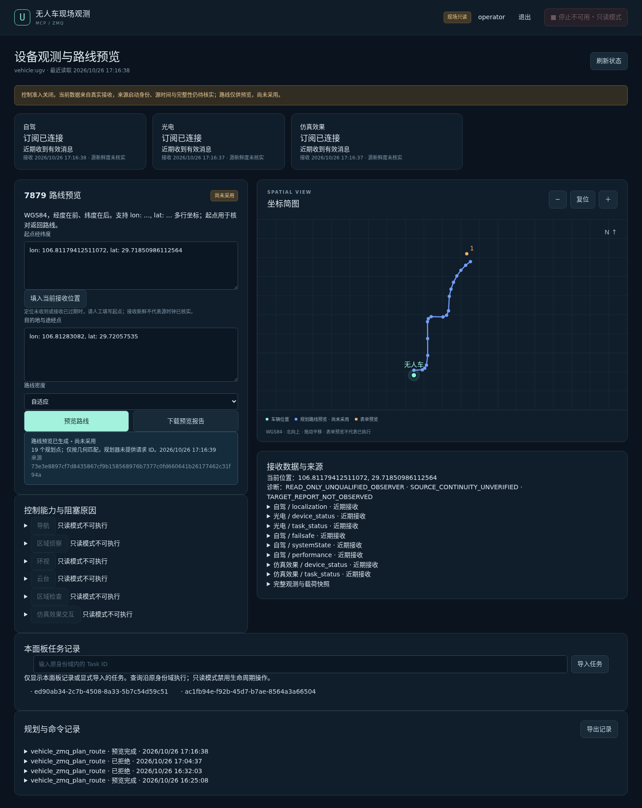

# 现场只读接入与 7879 路线预览验收记录

日期：2026-10-26（Asia/Shanghai）。范围：仅 SMPP；设备控制、SDAR 巡逻现场验收留待下一阶段。

## 交付状态

| 项目               | 状态与证据                                                                                                             |
| ------------------ | ---------------------------------------------------------------------------------------------------------------------- |
| 软件实现与工程门禁 | 通过。完整 13 项门禁均退出 0，后续历史读取和前端错误提示修复另有补充验证。                                             |
| 真实三路 ZMQ       | 自驾、光电、仿真效果均已连接并收到有效消息。初始未收到定位，最终已收到定位；目标报告仍未观察到。                       |
| 真实 7879 规划     | 通过。MCP／面板 API 获得 11 点路线；最终浏览器用新接收定位填写起点，获得 19 点路线。均为预览，未采用、未创建导航任务。 |
| 只读候选部署       | 已运行：MCP `http://127.0.0.1:19110/mcp`，面板 `http://127.0.0.1:19111/`，Provider 19109。沿用原操作员账号。           |
| 历史与重启         | 完整重启后既有预览未变化；两项显式导入任务的原 Context／业务报告可读。10 个已过期终态 handle 仍返回 `TASK_EXPIRED`。   |
| 局域网 HTTP        | 现有 `http://17.26.1.20:19101/` 原账号登录 200。此项是既有部署；候选仍只绑定回环。                                     |
| 19100／19101 交接  | **阻塞，未切换。** GOWM 中有 2 项活动 Runtime 任务、2 项活动 Provider 执行、2 条待处理命令。                           |
| 控制与巡逻         | 未验收。六项控制及生命周期接口由服务器拒绝，停止按钮禁用。SDAR 原精确绑定未变更。                                      |

本阶段软件、真实订阅与真实规划已通过。正式端口交接仍受现场条件阻塞，不能将其记作全部部署验收完成。

## 源码与合同

隔离工作树：`/home/sz/.codex/worktrees/trajectory-history-authority/sdar-mcp-provider-platform`。
交付分支：`codex/ugv-zmq-site-readonly-20261026`。

| 提交                                       | 内容                                               |
| ------------------------------------------ | -------------------------------------------------- |
| `15a357a1b0ced1a1b90e9b5edb679646f377ea37` | 起始版本                                           |
| `8af8f25c050f9ff4315e48254f44907b0f5dbb04` | 独立只读引导、共享规划器、精确目录、面板与集成验证 |
| `f6437a250c6f0a3be14a9de2230bf3d5144f5adf` | 原身份历史读取、HTTP 候选部署与交接复核修复        |
| `d7824dcd9b66493d0f16a6f46092e35bf4ca92bf` | 历史 Context 只读查询，禁止读取时触发终态归档      |
| `8243c2247b86128c0a1b15acc8198c5a11f96c7c` | 展开 MCP 嵌套规划失败原因，验证镜像导出再导入身份  |

目录为 **1.1.0 / `zmq_v1_1_0_readonly_13`**，实际目录哈希：
`c972bc0eb13d642d9b73752f9a5f79fda51fb495164576a74e50e08ec17b5006`。
冻结 MCP 协议仍为 2026-07-28；原 1.0.1 目录、冻结迁移、SDAR 绑定保持原合同。
主目录的 12 项未提交联合打包改动保留，最终状态在 `raw/protected-primary-status.txt`。

## 已实现的边界

- `site_readonly` 仅构造 SUB 观测链和规划客户端，不构造原生命令传输器、控制引擎或控制恢复。
- Provider 与 Runtime 同时拒绝六项控制、生命周期、人工输入和干预；关闭恢复、调度、命令派发、旧链路修复及清理扫描。
- 新增同步 `vehicle_zmq_plan_route(resourceId,start,waypoints,density)`。WGS84，经度在前；3 秒期限；同一端点在共享观测库中取得互斥锁。
- 7879 没有请求 ID；只接受通过起点、终点、途经点顺序与点数校验的候选，关联强度固定 `geometry_only_no_request_id`。20 米几何容差沿用现有规划适配器。
- 显式使用既有机场转换：106.81485／29.7195 锚点，xScale 111320、yScale 110540、世界 Y 向南。场景身份仍未确认；转换选择不授予控制准入。
- 结果保留实际规划点、完整接受帧、请求／转换／来源 SHA256；单帧超过 256 KiB 拒绝。错误或超时不生成替代路线。
- 预览记录在现有 command／audit JSONB 中先落库再调用；同 commandId 不重发，不创建导航任务，不生成已采用路线。
- 观测与控制准入分开显示；来源 epoch、源时钟、动作关联与完整检查证据不足仍列为阻塞项。
- 历史读取沿原执行身份和作用域，不延长 handle，不改写历史 Context、执行结果和占用状态。

## 现场证据

最终浏览器规划时间：2026-10-26 17:16:39，命令
`8d3349a5-b0be-45b5-a6ad-f7eb11c59ebf`，19 点、`preview_only`、`taskId=null`。
起点来自新接收定位；接收新鲜不代表源时间或设备关联已完成核验。

此前 API 命令 `e004747d-db93-44fd-b3e0-4b9cfaef2b77` 获得 11 点，来源帧 SHA 校验通过，
完整重启后预览 ID `d4a87a74-e9a8-4e46-847a-8a5c7ca4b893` 未变化。
使用历史起点的两次后续尝试超时，原始拒绝与截图保留；没有放宽几何校验或延长期限。
最终定位更新后，浏览器实测成功。初始浏览器探针还曾因本机 Playwright 默认二进制缺失退出 1，
随后使用已有 Chromium 执行成功，该失败日志一并保留。

三路接收状态、来源时间、新鲜度、原始观测和逐工具阻塞项见 `raw/site-device-final.json`。
`sourceProducerEpoch=null`、`sourceFreshness=unverified`、场景 ID 和控制端 ID 继续缺省。
目标报告缺失，不声明检查完整或“无发现”。

两个可读取原身份报告的活动任务：

- `ed90ab34-2c7b-4508-8a33-5b7c54d59c51`（区域侦察）。
- `ac1fb94e-f92b-45d7-b7ae-8564a3a66504`（区域检查）。

它们仍处于 working／STOPPING；读取成功不表示任务成功或检查证据完整。
历史 Context 修复前的缺失结果与修复后结果均保留；终态过期 handle 没有被刷新。

## 工程验证

完整门禁的 argv、cwd、开始／结束时间、退出码、源码指纹及日志哈希：
`verification-final-2/verification.json` 与 `source.json`。**13 项均退出 0，执行期间源码文件未变。**
首轮因生成目录的 JSON 排版失败的记录在 `verification-final-1/`，保留未覆盖。

| 验证                                                    | 结果                                                                           |
| ------------------------------------------------------- | ------------------------------------------------------------------------------ |
| 根目录与面板类型检查、构建，产品源码 Lint，改动格式检查 | 通过                                                                           |
| 冻结协议                                                | 11 个 Schema、74 个冻结案例、63 个锁定文件检查通过                             |
| ZMQ 冻结输入与新目录 pin                                | 17 项输入锁定、新 13 工具精确目录通过                                          |
| 原生／生命周期／观测／规划／真实 PostgreSQL             | 284 通过，1 项外部 SDAR 环境可选测试跳过                                       |
| 历史修复后的完整面板测试                                | 68 通过；其中只读／历史聚焦组 11 通过（有重叠，不累加）                        |
| 历史修复后的正式 MCP 与合同复核                         | 17 通过，1 项同样的外部 SDAR 可选测试跳过                                      |
| 最终只读浏览器                                          | 3 通过，含失败原因展开、无替代路线、禁用控制、登录、下载与刷新                 |
| 原面板浏览器回归                                        | 4 通过                                                                         |
| 镜像编译产物核对                                        | 3 个镜像合计 3145 个文件，0 不匹配；原生 zeromq 模块可在无网络、只读容器中加载 |

根目录 `pnpm lint` 曾遇到既有、被 Git 忽略的
`artifacts/inspection-area-v1/debug/vendor-managed.test.ts` 不在 TypeScript project service 内。
该文件保留；对 `apps packages scripts tests examples` 的完整产品源码 Lint 退出 0。
没有删除用户调试文件来改变门禁结果。补充验证日志与复现命令在 `supplemental-verification.json`。

## 镜像与部署

三个镜像都从固定 Node 基础镜像构建；最终文件与本地编译产物逐项校验。
标签中的不同源码提交对应各自最后一次功能修改，完整源码以交付分支及 bundle 文件哈希为准。

| 角色     | 标签                                                      | 镜像 ID                                                                   |
| -------- | --------------------------------------------------------- | ------------------------------------------------------------------------- |
| Provider | `smpp/ugv-zmq-provider:site-readonly-20261026-d7824dc`    | `sha256:aba3d3969cec1b3b204962f4831d10f506c4aa5c891259a8c980052d6db29bef` |
| Runtime  | `smpp/runtime:site-readonly-20261026-8af8f25`             | `sha256:9f3e6ae6b876f4fc34848a4c65f7a16af3d28f7c947dfc4ba4a0b5b4e26c2d79` |
| 面板     | `smpp/ugv-control-console:site-readonly-20261026-8243c22` | `sha256:b248a516be983a603346fb2a5870af6f6fe6a2302f15cd7569a1854e623b361c` |

配置与操作说明：`deploy/ugv-zmq/site-readonly/README.md`、`compose.yaml`。
应用容器使用非 root、只读根、cap_drop ALL、HTTP、私有配置绑定；候选不自动注册 PMS。
观测数据库 `smpp-zmq-site-observation` 与卷 `smpp_zmq_site_observation` 保留。
实际 GOWM 受限 `ugv_smpp_app` 账号通过 owner／binding 核验，应用启动不安装 GOWM 迁移。
原账号、GOWM 卷、绑定、PMS 配置与轨迹签名密钥均保留。

部署包包含源码、证据和三镜像，**不包含密码、私钥或实际数据库连接串**。
包外 `.receipt.json` 固定 sourceCommit、镜像 ID、文件数、大小及整包 SHA256；
包内 `bundle-manifest.json`／`SHA256SUMS` 固定每个文件。打包器重新导入 images.tar 并核对三镜像 ID，
再解读整个压缩包核验内容与模式。包身份使用外部 receipt，避免包自引用哈希。

## 交接阻塞与后续入口

`raw/site-handoff-final.json`：检查退出 **2**，Runtime 活动 2、Provider 活动 2、待处理命令 2；
未决 admission 0、未确认原生 dispatch 0、原生占用 0、有效 lease 0。
`databaseIdle=false`；仍缺少准入隔离、旧写端停止与可信来源空闲证明。
没有清除任务、取消设备动作或改写占用来满足交接。

所以 19100／19101 未更新。既有旧适配器反复因 ETIMEDOUT 重启，不能宣称它是健康可控的回退版本。
回退候选通过停止这三项候选应用或恢复上一镜像完成，保留观测卷、任务、报告、审计、账号与版本历史。

下一阶段按顺序处理：

1. 对现有任务及待处理命令完成受治理的对账与交接，获得旧写端停止证明后再切换正式端口。
2. 确认场景／设备来源、源时钟与重启 epoch；核实缺省底盘发令身份。
3. 补齐动作关联、重启恢复对账、检查目标／事件流完整补取与覆盖证据。
4. 完成控制准入证据后，再进行实际设备控制和 SDAR 巡逻验收。
